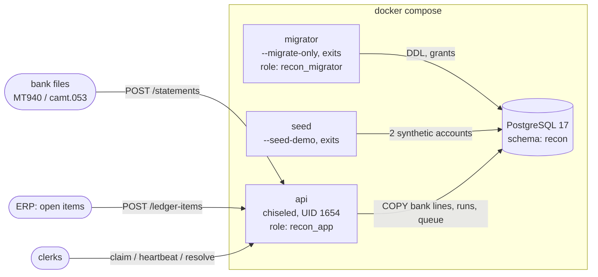
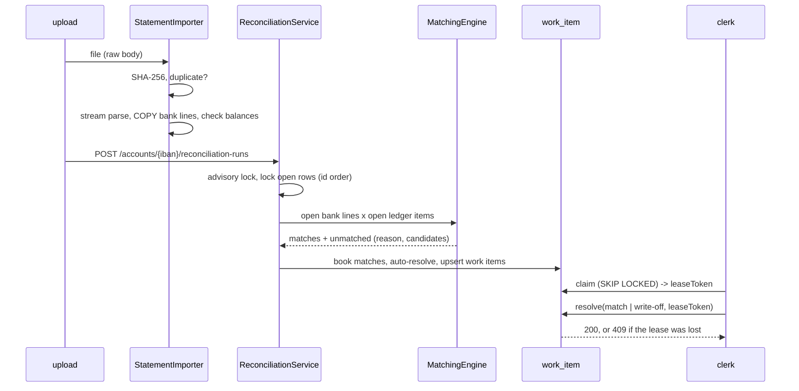

# bank-statement-recon

[](https://github.com/hekimcan206/bank-statement-recon/actions/workflows/ci.yml)
[](https://github.com/hekimcan206/bank-statement-recon/actions/workflows/codeql.yml)


[](LICENSE)

Bank statement reconciliation for corporate accounts: streaming **MT940** and **camt.053** parsers, a rule-based
matcher (amount, date tolerance, reference similarity, one-to-many and many-to-one), and a **work queue** with leases
for whatever the matcher refuses to guess. .NET 10 and PostgreSQL 17.

> All data is synthetic; no real bank, personal or company data. IBANs carry valid check digits under
> the invented bank code 99901, and company names are built from word lists.

## Problem

Every morning a finance team receives yesterday's statements and has to say, for each movement, which open invoice
or payable it settles. The hard part is not reading the file, it is the noise:

- **Formats.** MT940 is a 1990s line format whose free-text field `:86:` has no common structure (German GVC
  subfields, Benelux `/KEY/` keywords, plain upper-case Turkish text). camt.053 is XML in a dozen versions that
  disagree on where a name or an amount lives. Files can hold hundreds of thousands of entries and are uploaded by
  people, so they are untrusted input.
- **References.** Payers mistype invoice numbers, drop separators, or leave them out; MT940 cuts the customer
  reference at 16 characters.
- **Amounts.** Banks deduct transfer charges; customers pay three invoices in one transfer or one invoice in
  instalments; round amounts (2,500.00) collide all the time.
- **Names.** `ŞİMŞEK GIDA LTD ŞTİ`, `SIMSEK GIDA` and `Şimşek Gıda Ltd. Şti.` are the same company, and a
  culture-sensitive upper-case of `i` gives a different answer on a Turkish server.

A wrong automatic match is worse than no match: it hides a real difference. So the system has to match aggressively
where the evidence is strong, refuse where it is not, and get the refusals to a person exactly once.

## Solution

| Concern | How |
|---|---|
| Parsing | Own streaming readers emitting one format-neutral model: MT940 (plain and FIN-wrapped, entry-date year inference, reversals, three `:86:` dialects, UTF-8/Windows-1254 detection) and camt.053 001.02-001.13 via `XmlReader`, one `Ntry` in memory at a time. Opening + movements must equal closing. Only `StatementFormatException` ever escapes ([ADR 0001](docs/adr/0001-streaming-parsers-with-a-format-neutral-model.md)) |
| Matching | Ordered passes: exact reference, unique amount (per counterparty if needed), fuzzy score (Jaro-Winkler with digit-aware and truncation-aware corrections, soft token-set names) with an **ambiguity guard**, then many-to-one / one-to-many by bounded **subset-sum**. Repeats until nothing new matches, so runs are idempotent ([ADR 0002](docs/adr/0002-rule-passes-with-ambiguity-guard-and-bounded-subset-sum.md)) |
| Work queue | PostgreSQL table: claim with `FOR UPDATE SKIP LOCKED`, lease + heartbeat, **fencing token** on every write, manual match or write-off in one transaction, fixed lock order against reconciliation runs ([ADR 0003](docs/adr/0003-work-queue-with-leases-and-fencing-tokens.md)) |
| Integrity | File SHA-256 and `UNIQUE NULLS NOT DISTINCT (account, statement, sequence)` against double import; `UNIQUE` on match links so an item is in at most one match; least-privilege roles (no `DELETE`, no rewriting imported facts) |
| Proof | Golden files, FsCheck round-trip properties, mutation fuzzing, matcher properties, Testcontainers PostgreSQL tests, a labelled synthetic set with hold-out seeds ([ADR 0004](docs/adr/0004-synthetic-labelled-data-and-testing-strategy.md)) |

## Architecture





## Why this design

- **Streaming over convenience.** A naive importer that materialises the file first needs memory proportional to the
  file; the streaming path stays flat (measured below) and feeds a binary `COPY` directly.
- **Rules over one global score.** Each match can be explained in one line (`reference 0.97, counterparty 1.00,
  amount difference -12.50, value date +2 day(s)`), and the matcher can say "I don't know" with candidates attached.
- **The queue lives next to the data.** Resolving an item books a match and changes bank lines, ledger items and
  other queue items atomically. A broker would split that transaction.
- **Leases plus fencing tokens.** A lease alone cannot tell a dead clerk from a slow one; the token makes the slow one
  harmless.
- **Relation to [ledger-recon](https://github.com/hekimcan206/ledger-recon).** ledger-recon is about exactly-once
  posting in a double-entry ledger with a simple MT940 subset. This repository is the statement side in depth: both
  formats, dialects, fuzzy and group matching, measured precision, and the human work queue.

## Quick start

```bash
docker compose up -d --build        # postgres, migrator, seed (2 synthetic accounts), api
docker compose logs seed            # per account: matches by rule, queued items
```

The API listens on `http://localhost:58680` (Scalar UI at `/scalar`). Every `/api` call needs the demo key.

```bash
KEY="X-Api-Key: demo-key-dev-only"; API=http://localhost:58680/api/v1
ACC=TR079990100000000100000011      # the MT940 demo account

curl -s -H "$KEY" $API/accounts/$ACC/summary
curl -s -H "$KEY" -H 'Content-Type: application/json' \
     -d "{\"workerId\":\"alice\",\"account\":\"$ACC\"}" $API/work-items/claim     # -> id, leaseToken, candidates
curl -s -H "$KEY" -H 'Content-Type: application/json' \
     -d '{"workerId":"alice","leaseToken":1,"action":"write-off","note":"bank charge"}' $API/work-items/<id>/resolve
curl -s -H "$KEY" --data-binary @samples/camt053-v08-batch.xml $API/statements   # 201, then 200 "duplicate": true
```

Seed output (abridged, from this machine):

```json
{"account":"TR079990100000000100000011","style":"TurkishFreeText","ledger":{"received":401,"inserted":401},
 "run":{"bankLines":337,"ledgerItems":401,"matches":275,
        "matchesByRule":{"ExactReference":151,"AmountDate":53,"Fuzzy":24,"ManyToOne":24,"OneToMany":23},"queued":106}}
```

Local development: `docker compose up -d postgres migrator`, then `dotnet run --project src/BankRecon.Api`
(launch settings point at `localhost:58632` as `recon_app`). Tests: `dotnet test` (Docker required for the
integration suite).

## Results (measured)

Measured on a shared, busy laptop (i7-13620H, 16 GB RAM with about 0.5 GB free, CPU 44-46 % busy before the runs,
about ten other containers). Medians; method, raw output and caveats in [docs/benchmarks.md](docs/benchmarks.md).

**Matching on labelled synthetic statements** (20 hold-out seeds x 2,000 ledger items per format, through the real
file format; pair-level):

| Configuration | Precision | Recall | Queue share |
|---|---|---|---|
| Same amount within 5 days, first fit (baseline) | 0.642-0.690 | 0.389-0.468 | 36-41 % |
| Exact reference only | 1.000 | 0.434-0.551 | 48-57 % |
| + unique amount + fuzzy | 0.999-1.000 | 0.640-0.755 | 28-37 % |
| **Full (with one-to-many / many-to-one)** | **0.999** | **0.979-0.988** | **13-15 %** |

Ranges span the four file styles (MT940 Turkish free text, GVC subfields, SEPA keywords; camt.053.001.08).

| Measurement | Result |
|---|---|
| MT940 streaming parse, 500,000 entries (58 MB) | 0.52 s, ~960,000 entries/s, peak managed heap 12 MB (buffered: 195 MB) |
| camt.053 streaming parse, 150,000 entries (167 MB) | 1.81 s, ~83,000 entries/s, peak heap 12 MB (buffered: 85 MB) |
| In-memory matching, 1,000 / 5,000 / 20,000 ledger items | 0.24 s / 2.9 s / 37.8 s (grows faster than linearly) |
| Statement import into PostgreSQL (binary COPY) | 8,800-16,000 bank lines/s |
| Reconciliation run on PostgreSQL, 2,000 / 10,000 ledger items | 4.2 s / 44.5 s (dominated by per-match round trips) |
| Work-queue drain, 3,000 items, 1 / 4 / 16 workers | 32 / 169 / 317 items/s, 0 double claims |
| Crash simulation (8 workers, every 10th claim abandoned, 5 s lease) | every item resolved exactly once |

Tests: 110 unit, golden, property and fuzz tests and 20 Testcontainers PostgreSQL integration tests.

## Limitations and next steps

- **Synthetic evaluation.** The generator and the matcher were written by the same person; tuning used seeds 1-3 and
  the reported numbers use hold-out seeds, but real statements will contain patterns the generator lacks. The numbers
  show the relative value of each rule and guard against regressions.
- **Turkish MT940 variants** are modelled from public format descriptions and general practice (IBAN in `:25:`,
  TRY, upper-case free-text `:86:`, Turkish letters in UTF-8 or Windows-1254); no bank-specific implementation guide
  was available to test against, so the Turkish samples are synthetic, not copies.
- **No XSD validation** of camt.053 (schemas were not available offline); the writer follows the published element
  order and both versions round-trip through the reader.
- **Encoding detection** looks at the first 64 KiB of an MT940 file only.
- **Structurally ambiguous cases** remain: an unexpected receipt from a customer with an open invoice of the same round
  amount, or whose invoices add up to it, is matched by the unique-amount or group rule. Turning those rules off for
  name-only evidence trades the errors for lower recall; it is a configuration decision, not a bug.
- **Run size.** A reconciliation run matches inside its transaction while holding the account's open rows; above
  roughly 10,000 open items per account (on this host) the matching exceeds the 30 s idle-in-transaction limit. Large
  accounts need snapshot, match outside the transaction, verify-and-book; match inserts should be batched.
- **Matching cost** grows faster than linearly with the open items of one account (group search over a 15-day
  window); an index by counterparty token is the fix.
- **Groups** search at most 20 related candidates and 5 members; larger bulk payments go to the queue.
- **Authentication** is a shared API key and the worker id is self-asserted; production needs an identity provider
  and per-user audit. No append-only audit log or signed decision history yet.
- **Multi-currency**: matching never crosses currencies; FX conversion and fee posting are out of scope.
- **Next**: CAMT.052/054 intraday reports, learned weights from resolved queue items, a small review UI.

## Privacy note (KVKK)

KVKK is the Turkish Personal Data Protection Law. Statements name counterparties, some of whom are natural persons.
This repository ships only synthetic data; a deployment must define retention for narratives and names, restrict
queue access, and log decisions per user ([threat model](docs/threat-model.md)).

## License

[MIT](LICENSE)
